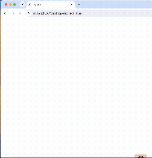

# Mobile Web Automation Framework (Python + Selenium + Chrome Mobile Emulation)

A reusable UI test automation framework that drives **Google Chrome** with
**Selenium 4** and **pytest**, using Chrome's **mobile emulation** (or plain
desktop Chrome). It follows the **Page Object Model (POM)** and keeps three
things separate:

| Layer | Folder | Knows about |
|-------|--------|-------------|
| Framework | `framework/`, `config/`, `conftest.py` | Browsers, devices, waits, popups, screenshots — **no website** |
| Page Objects | `pages/<site>/` | One website's pages: locators and page actions |
| Tests | `tests/<site>/` | Test steps, assertions and **test data** (URLs, search terms…) |

It ships with one example test case for Twitch. Adding another website means
adding `pages/<site>/` and `tests/<site>/` — the framework itself doesn't change.

---

## Project structure

```
mobile-web-automation/
├── .vscode/
│   ├── launch.json             # Run/Debug: current file, all tests, headless
│   └── settings.json           # Enables pytest in VS Code's Testing panel
├── config/
│   └── settings.py             # Framework-only settings: device, headless, timeouts, folders
├── framework/                  # Website-independent code
│   ├── base_page.py            # Waits, click/type/scroll, popup handling, screenshots
│   ├── driver_factory.py       # Builds Chrome (any emulated device, or desktop)
│   └── logger.py               # Console + one log file per run in logs/
├── pages/
│   └── twitch/                 # Page Objects for twitch.tv
│       ├── twitch_base_page.py # Twitch's popups
│       ├── home_page.py
│       ├── search_page.py
│       └── streamer_page.py
├── tests/
│   └── twitch/
│       └── test_search_streamer.py   # TC-001 (test data at the top of the file)
├── screenshots/                # Screenshots (+ FAILED_*.png on failure)
├── reports/                    # pytest-html report (report.html)
├── logs/                       # Run logs
├── conftest.py                 # `driver` fixture, --device/--headless options, failure screenshots
├── pytest.ini                  # Markers and default pytest options
├── requirements.txt
└── README.md
```

---

## Example test — TC-001: Search a game on Twitch and open a streamer



File: `tests/twitch/test_search_streamer.py`. Its test data sits at the top of the file:
```python
BASE_URL = "https://www.twitch.tv/"
SEARCH_TERM = "StarCraft II"
SCROLL_TIMES = 2
STREAMER_INDEX = 0
```

| # | Step | Implemented in |
|---|------|----------------|
| 1 | Go to `BASE_URL` | `HomePage.load()` |
| 2 | Click the search icon | `HomePage.click_search_icon()` |
| 3 | Input `SEARCH_TERM` | `SearchPage.search()` |
| 4 | Click the Channels tab | `SearchPage.click_channels_tab()` |
| 5 | Scroll down `SCROLL_TIMES` times | `BasePage.scroll_down()` |
| 6 | Select one streamer | `SearchPage.select_streamer()` |
| 7 | Wait until the streamer page shows its videos (`with_video`) or the "no content" message (`no_video`), take a screenshot | `StreamerPage.wait_until_loaded()` + `take_streamer_screenshot()` |

**Expected result:** the browser is on the selected streamer's channel page and
a screenshot is saved as `screenshots/streamer_<channel>_<timestamp>.png`.

---

## Prerequisites

- **Python 3.9+** — on macOS use `python3` (install from python.org if `python3 --version` fails)
- **Google Chrome**
- Internet access

No manual ChromeDriver download is needed: Selenium 4.6+ includes **Selenium
Manager**, which fetches the matching driver automatically on the first run.

---

## Setup (VS Code)

1. **File → Open Folder… →** `mobile-web-automation`
2. **Terminal → New Terminal**, then create a virtual environment:

   **macOS / Linux**
   ```bash
   python3 -m venv .venv
   source .venv/bin/activate
   ```
   **Windows (PowerShell)**
   ```powershell
   python -m venv .venv
   .\.venv\Scripts\Activate.ps1
   ```
3. Install dependencies:
   ```bash
   pip install -r requirements.txt
   ```
4. `Cmd/Ctrl+Shift+P` → **Python: Select Interpreter** → choose `.venv`.

---

## Running tests

```bash
pytest                                   # everything
pytest tests/twitch                      # one website
pytest tests/twitch/test_search_streamer.py   # one file
pytest -m twitch                         # by marker (smoke, mobile, twitch, ...)
pytest --headless                        # no browser window
pytest --device "iPhone 12 Pro"          # emulate another device for this run
pytest --device desktop                  # normal desktop Chrome
pytest --reruns 2                        # retry flaky tests (pytest-rerunfailures)
```

In VS Code: use the **Testing** panel (flask icon), or **Run and Debug**
(`Cmd/Ctrl+Shift+D`) → *Run current test file* to run with breakpoints.

### Choosing the device

Highest priority first:

1. `--device` on the command line — applies to the whole run
2. `@pytest.mark.device("...")` on a test — for a test that needs a specific device
3. `DEVICE_NAME` in `config/settings.py` — the default (`Pixel 7`)

Any Chrome DevTools device name works (`"Pixel 7"`, `"iPhone 12 Pro"`,
`"Samsung Galaxy S20 Ultra"` …), plus `"custom"` (the metrics in
`CUSTOM_DEVICE`) and `"desktop"` (no emulation).

---

## Results

| Output | Location |
|--------|----------|
| Screenshots taken by tests | `screenshots/<name>_<timestamp>.png` |
| Screenshot on failure | `screenshots/FAILED_<test_name>.png` (also embedded in the report) |
| HTML report | `reports/report.html` |
| Log | `logs/<YYYY-MM-DD_HH-MM-SS>.log` — one file per run, named after when the run started |

---

## Configuration (`config/settings.py`)

Only framework settings live here. Each can also be set as an environment variable.

| Variable | Default | Purpose |
|----------|---------|---------|
| `DEVICE_NAME` | `Pixel 7` | Default emulated device (`desktop` = no emulation) |
| `HEADLESS` | `false` | Run without a visible window |
| `BROWSER_LANG` | `en-US` | Language Chrome asks websites for |
| `EXPLICIT_WAIT` | `20` | Default wait timeout (s) |
| `PAGE_LOAD_TIMEOUT` | `45` | Page-load timeout (s) |
| `POPUP_WAIT` | `3` | How long to keep looking for late-appearing popups (s) |

Test data (URLs, search terms, counts, accounts…) belongs in the test file, not here.

---

## What the framework gives every page (`framework/base_page.py`)

| Method | What it does |
|--------|--------------|
| `open(url)` | Navigate and wait for the DOM to be ready |
| `wait_visible` / `wait_clickable` / `wait_for_url_contains` | Explicit waits (with an optional failure `message`) |
| `wait_for_document_ready()` | Wait for `document.readyState == "complete"` |
| `wait_for_any({"name": locator, ...})` | Wait until any of the locators is visible and return its name; the first listed wins a tie |
| `click(el, name)` | Real user click (no JavaScript fallback). If the element is covered, not interactable or stale, it logs an error naming the element and the test fails |
| `type_text(el, text, submit=False)` | Clear, type, optionally press Enter |
| `scroll_down(times)`, `scroll_into_view(el)`, `is_in_viewport(el)` | Scrolling helpers |
| `dismiss_popups()` | Close any popup listed in the page's `POPUP_LOCATORS` |
| `take_screenshot(name)` | Save a timestamped PNG and return its path |

All waits are explicit (implicit wait is 0) to avoid slow, flaky mixed waits.

---

## Adding a new test for an existing site

1. Create `tests/<site>/test_<something>.py`.
2. Put the test data at the top of the file as constants.
3. Use the `driver` fixture and the site's page objects:

```python
import pytest
from pages.twitch import HomePage

BASE_URL = "https://www.twitch.tv/"
SEARCH_TERM = "Age of Empires IV"

@pytest.mark.twitch
def test_search_returns_channels(driver):
    search = HomePage(driver, BASE_URL).load().click_search_icon()
    search.search(SEARCH_TERM).click_channels_tab()
    assert search.streamer_links(), "Expected at least one channel in the results"
```

To run the same test with several inputs, use `@pytest.mark.parametrize`:

```python
@pytest.mark.parametrize("search_term", ["StarCraft II", "Age of Empires IV"])
def test_search(driver, search_term):
    ...
```

---

## Adding a new website

1. **Site base page** — `pages/<site>/<site>_base_page.py`: inherit from
   `BasePage`, set the site's `POPUP_LOCATORS`, and keep its base URL.
2. **Page objects** — one class per page in `pages/<site>/`, inheriting from the
   site base page. Locators at the top of the class, actions as methods that
   return the next page object.
3. **Tests** — `tests/<site>/test_*.py`, with the test data at the top.
4. Optionally add a marker for the site in `pytest.ini`.

Rules of thumb that keep it maintainable:

- Tests never call Selenium directly — only page-object methods.
- Locators live only in page objects. When a site changes, you fix one place.
- Anything that would work on any website goes in `framework/`; anything
  specific to one site goes in `pages/<site>/`.
- Test data goes in the test file (or a parametrize list), not in `config/`.

---

## Twitch notes

- `TwitchBasePage.POPUP_LOCATORS` closes the "open in app / continue in
  browser" bottom sheet by clicking the `<button>` that follows the
  `<a>` whose href contains `open_in_app`. Add a locator here when a new popup
  shows up.
- The search icon is the bottom-bar link `<a href="/directory">` that is directly
  followed by `<a href="/activity">` (`HomePage.SEARCH_ICON`). If it isn't found,
  the test fails with a clear message and a failure screenshot.
- The search box is `<input type="search">` (`SearchPage.SEARCH_INPUT`).
- The Channels tab is the `<a>` whose href ends with `type=channels`, in the 2nd
  `<li>` of `<ul role="tablist">` (`SearchPage.CHANNELS_TAB`). After clicking,
  the test waits for it to become `aria-selected="true"`.
- Streamers are the `<a href>` links in `<div role="list"> > <div>`
  (`SearchPage.STREAMER_LINKS`); the channel name comes from the href
  (e.g. `/starcraft` → `starcraft`).
- `StreamerPage.wait_until_loaded()` handles both kinds of channel and returns
  which one it found. It waits for whichever appears first:
  - `"no_video"`: the title (`p.tw-title`) of the empty-state block directly
    after the channel tabs (`div.tw-tabs`), inside
    `main#page-main-content-wrapper` (`NO_VIDEO`).
  - `"with_video"`: a video thumbnail, `img[src*='https']` inside
    `button[role='link']` (`VIDEO_THUMBNAIL`). Scoping it to the card button
    keeps the streamer's avatar from counting. It then waits until every
    thumbnail on screen has finished downloading (`img.complete` and
    `naturalWidth > 0`), so the screenshot doesn't show black placeholders.
    Off-screen thumbnails are skipped because they lazy-load only when scrolled to.

  If neither appears, the test fails.
- Generated class names like `Layout-sc-1xcs6mc-0` are never used, since Twitch
  changes them often.

---

## Troubleshooting

| Problem | Fix |
|---------|-----|
| `command not found: python` (macOS) | Use `python3`; inside the activated `.venv`, `python` works too |
| `SessionNotCreatedException` / driver errors | Update Chrome and run `pip install -U selenium` |
| An element isn't found | The site changed its markup — inspect it (DevTools, device toolbar on) and update the locator in `pages/<site>/` |
| A new popup blocks the page | Add its locator to the site base page's `POPUP_LOCATORS` |
| Flaky on a slow network | Raise `EXPLICIT_WAIT`, or run `pytest --reruns 2` |
